# Mi primer video juego con Phaser Desktop

Para acceder a la plataforma *Phaser* para crewar tu primer video juego da click https://phaser.io/.

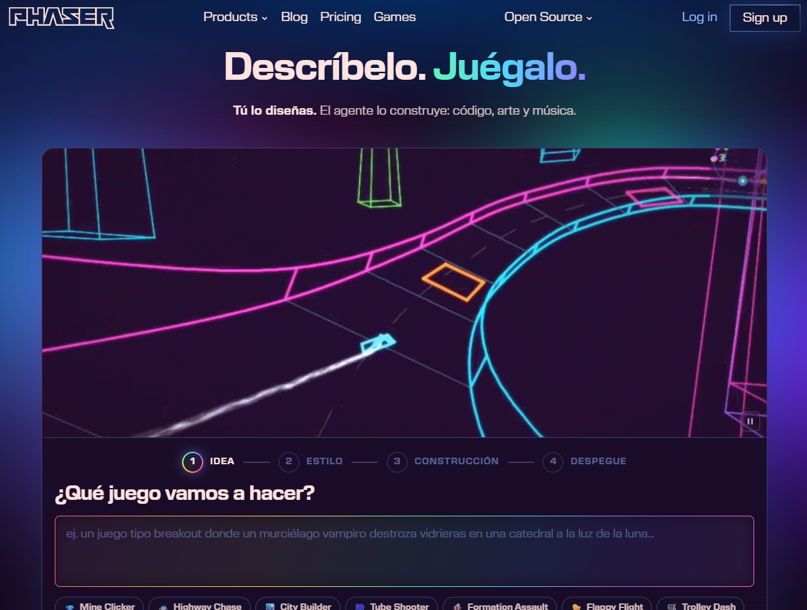

## Antes de construir el juego

1. Requieres una cuenta de correo electrónico de *Google* (preferentemente) o *Microsoft* a la cual puedas acceder (de uso frecuente).
2. Accede a tu sesión de correo.
3. Crea una cuenta en Phaser, accede directamente desde aquí https://phaser.io/login y presiona en la opción de tu proveedor de correo electrónico.

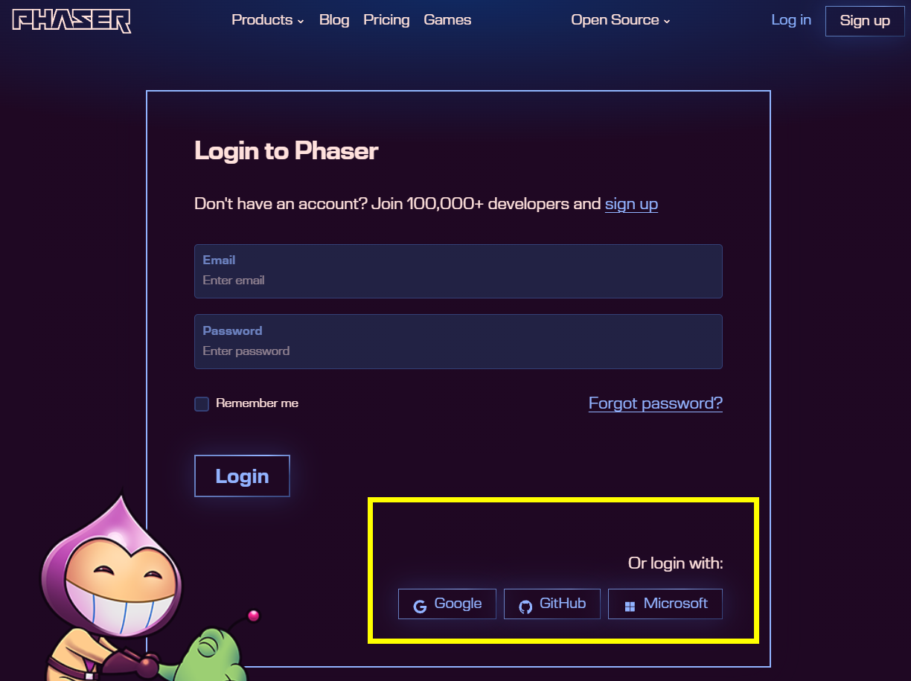

4. Concede permisos para que Phaser reconozca tu nombre y correo dando click en *Continuar*

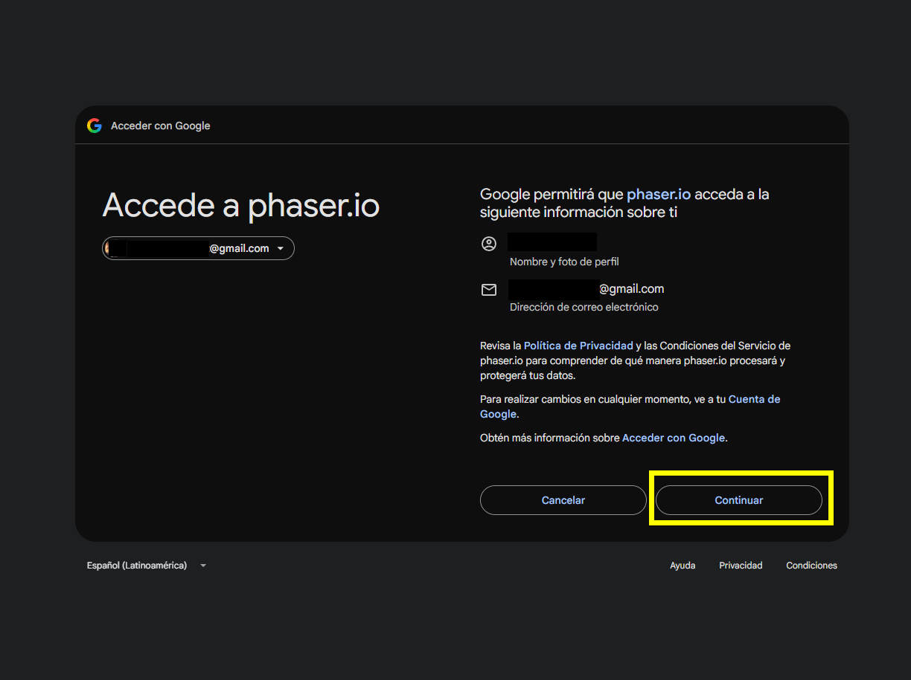

5. Verifica si tus datos son correctos !Ya estas listo para comenzar! Selecciona la opción *Open the Phaser Desktop*.

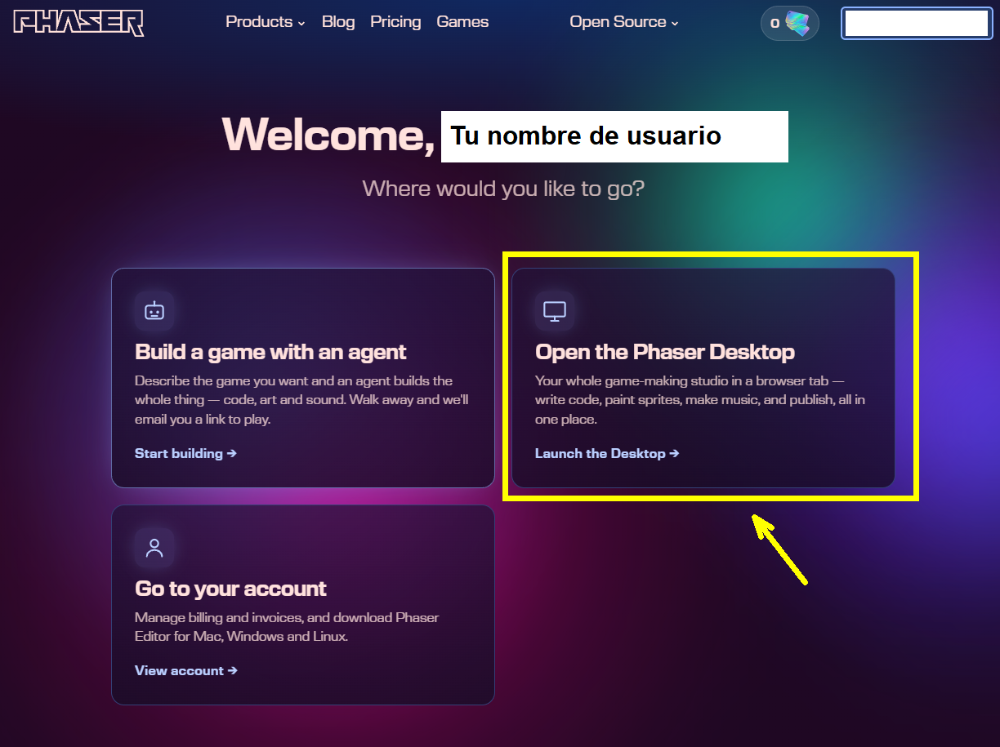

6. Selecciona la opción *Arcade*

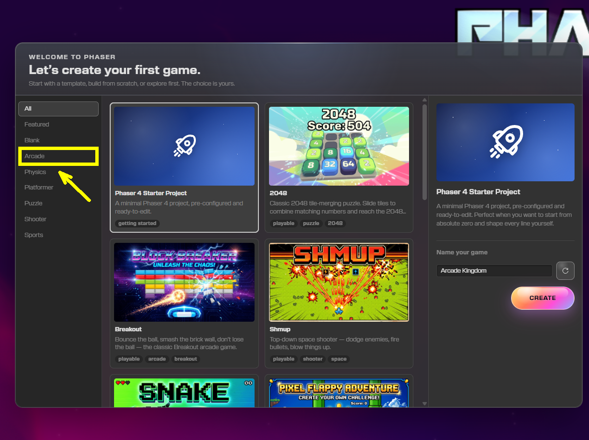

7. Selecciona *Snake* y asigna un nuevo nombre a tu juego (el de tu preferencia).

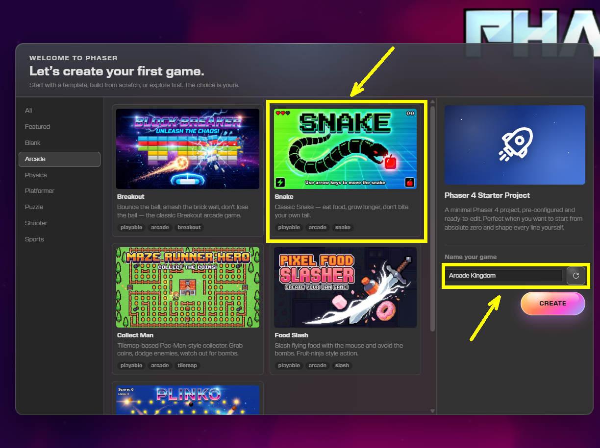

8. Una vez abierto su nuevo *Desktop* espera instrucciones ...

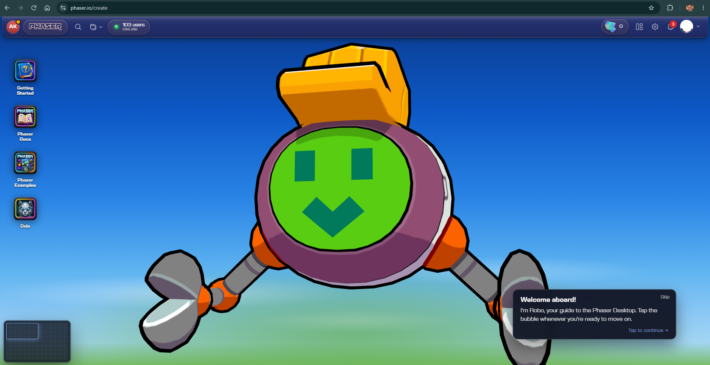

## Ahora a programar tu juego

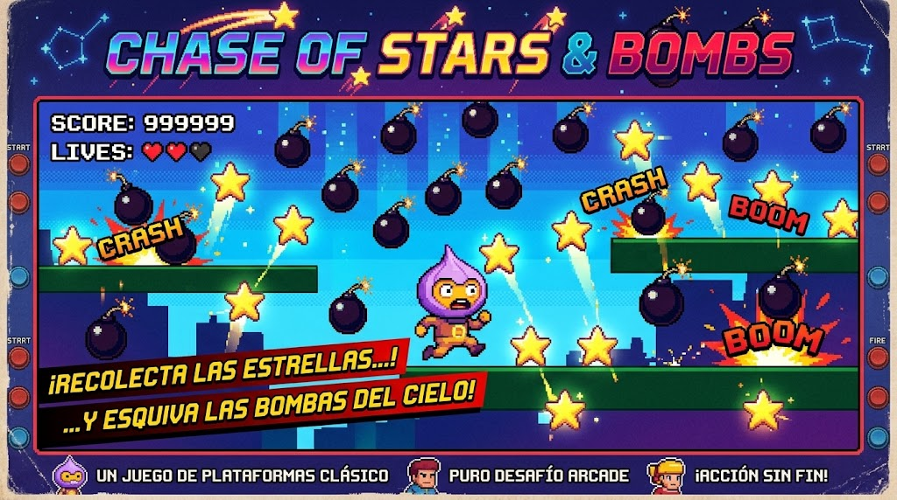

1. Accede al código del juego que vas a construir. Da click en el botón que aparece en la parte superior izquierda (Tiene las iniciales del nombre que le diste a tu juego).

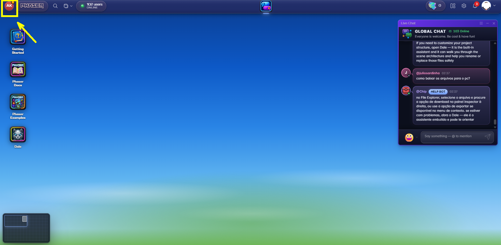

2. Selecciona *Code Editor* para abrir el editor de código de tu juego.

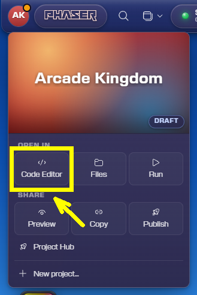

3. Verifica que el editor se abra.

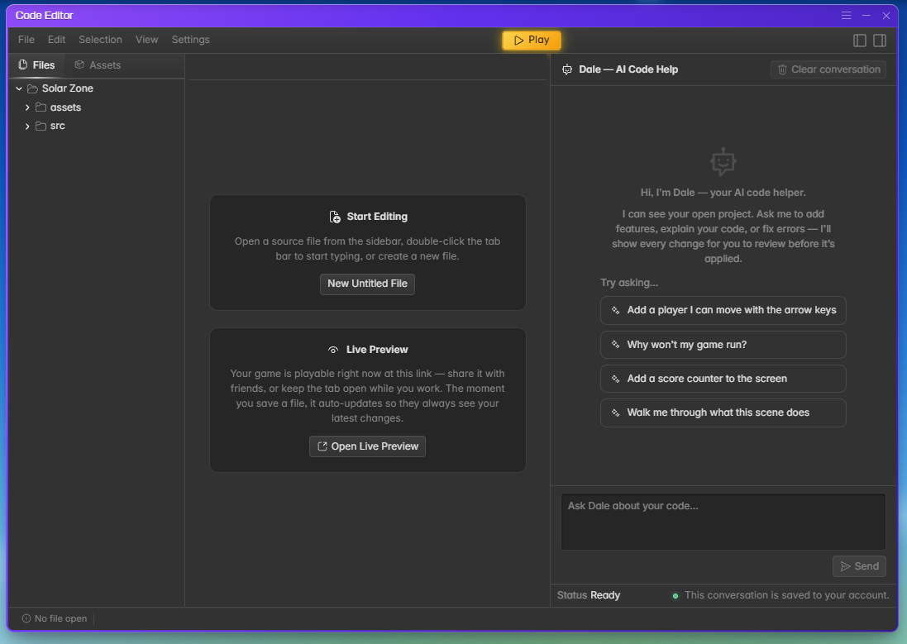

4. ¿Cómo ejecutar el video juego? Identifica en la parte superior del editor el botón `Play` y presiona para ver cómo funciona tu video juego.

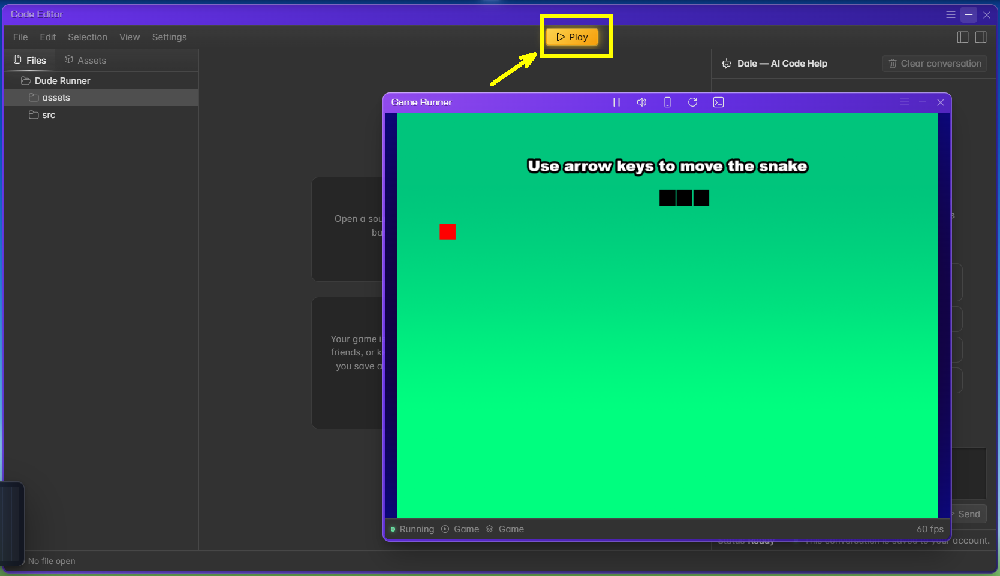

5. **Configura el tamaño de la pantalla**. Dentro del editor abre el archivo `main.js` (dentro de la carpeta `src`) y cambia los valores de `width` y `height`.

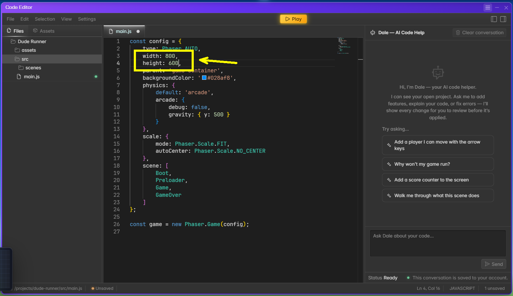

**NOTA:** Cada vez que realices una modificación es necesario guardar los cambios. Para salvar los cambios ve al menú superior y selecciona `File` y luego da clic en `Save`, o bien, utiliza la combinación de teclas `Ctrl` + `s`.

6. **Cargando los recursos**. Abre el archivo `preloader.js` dentro de la carpeta `scenes` y dentro del archivo ubica el segmento `preload()`.

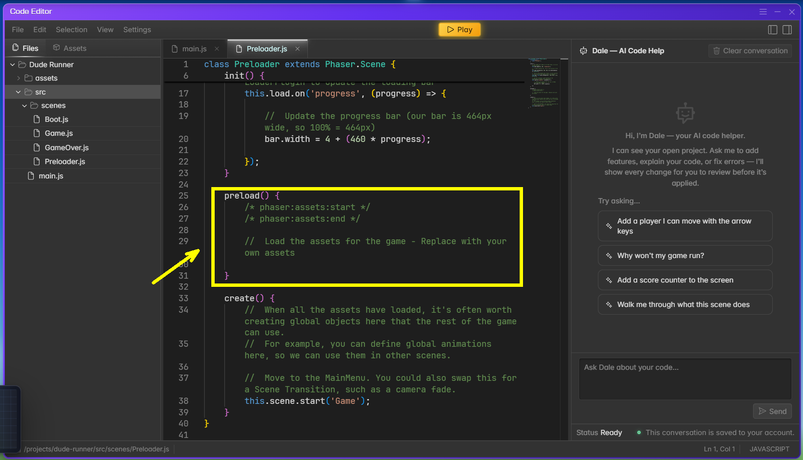

Sustituye el contenido del segmento por el siguiente código: 

```Javascript
preload() {
        /* phaser:assets:start */
        /* phaser:assets:end */

        //  Load the assets for the game - Replace with your own assets
        //  Load the assets for the game - Replace with your own assets
        
        this.load.image('sky', 'https://cdn.jsdelivr.net/gh/danielvazquez-utp/myfirstProject-Phazer@main/assets/sky.png');
        this.load.image('ground', 'https://cdn.jsdelivr.net/gh/danielvazquez-utp/myfirstProject-Phazer@main/assets/platform.png');
        this.load.image('star', 'https://cdn.jsdelivr.net/gh/danielvazquez-utp/myfirstProject-Phazer@main/assets/star.png');
        this.load.image('bomb', 'https://cdn.jsdelivr.net/gh/danielvazquez-utp/myfirstProject-Phazer@main/assets/bomb.png');
        
        this.load.spritesheet(
            'dude',
            'https://cdn.jsdelivr.net/gh/danielvazquez-utp/myfirstProject-Phazer@main/assets/dude.png',
            {
                frameWidth: 32,
                frameHeight: 48
            }
        );

        this.load.audio('footstep', [
            'https://cdn.jsdelivr.net/gh/danielvazquez-utp/myfirstProject-Phazer@main/assets/footstep.ogg',
            'https://cdn.jsdelivr.net/gh/danielvazquez-utp/myfirstProject-Phazer@main/assets/footstep.mp3'
        ]);
        this.load.audio('bomby', [
            'https://cdn.jsdelivr.net/gh/danielvazquez-utp/myfirstProject-Phazer@main/assets/sci-fi.mp3'
        ]);
    }

```
En este punto se han agregado los recursos necesarios para el juego, tal como:
- Imagenes:
    - estrella
    - bomb4
    - piso
    - personaje principal
- Sonido:
    - pasos
    - liberación de las bomb4s


7. **Agregando al jugador**. Ahora, en necesario agregar una nueva carpeta de recursos adicionales la cual nombraremos `gameObjects` dentro de la carpeta `src`, dentro de la cual agregaremos un nuevo archivo `Player.js`.

Abre, el explorador de archivos presionando el botón `Phaser` y posteriormente, selecciona `File explorer`.

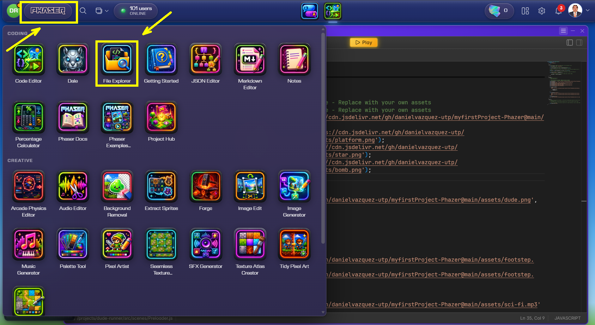

Una vez abierto el explorador, busca dentro de la carpeta `Projects`>`nombre de tu proyecto`>`src` y crea la nueva carpeta `gameObjects`. Para crear una nueva carpeta, da clic derecho sobre el espacio de la carpeta `src` y selcciona `New folder`.

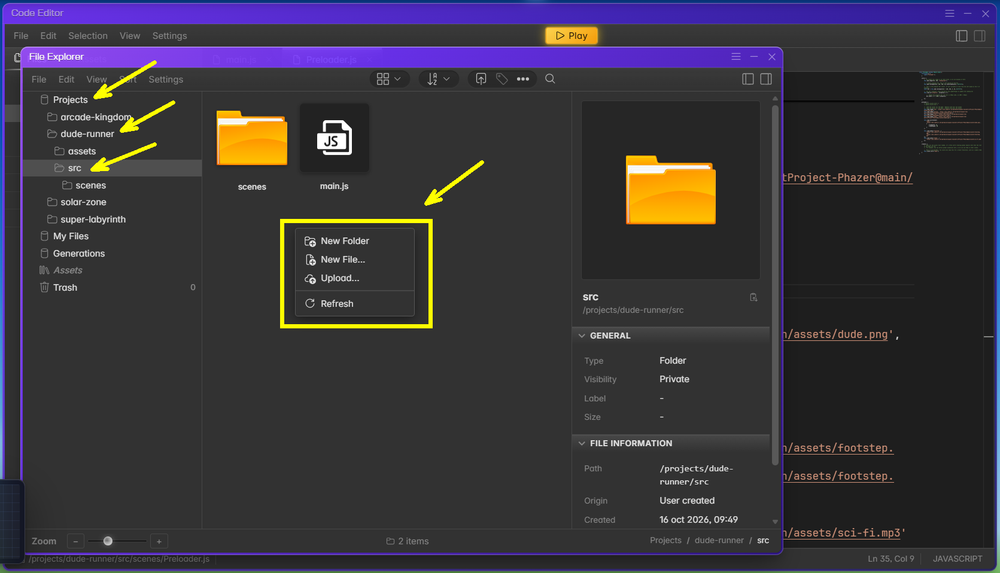

Escribe el nombre y confirma presionando el botón `Create`.

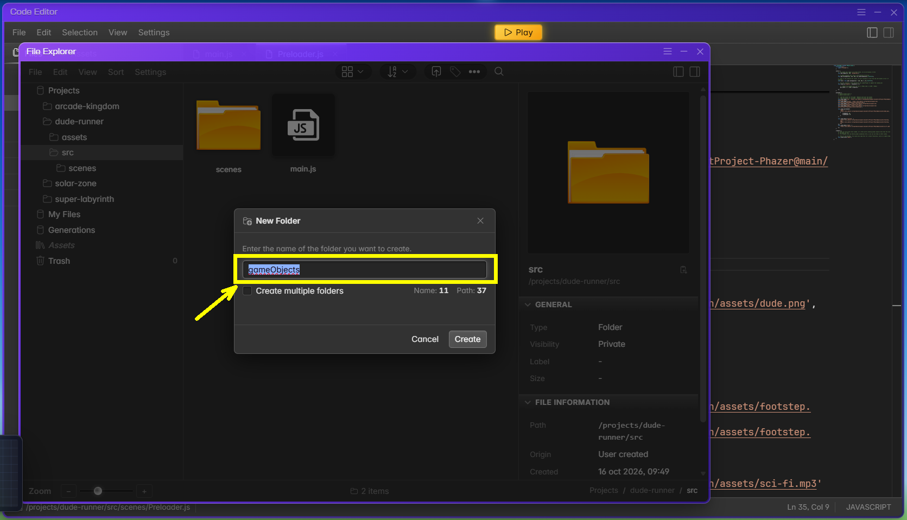

Ahora, dentro de la carpeta `gameObjects` crea un nuevo archivo al cual nombrarás `Player.js`

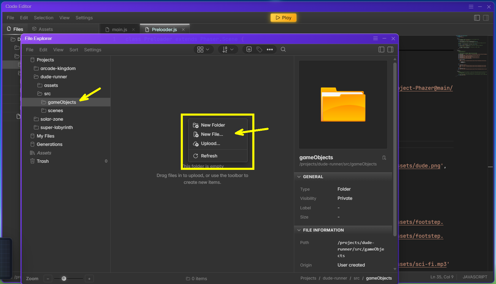

8. **Creando al jugador principal**. Regresa al editor de código y abre el archivo `Player.js` y pega el siguiente código:

```Javascript
class Player extends Phaser.Physics.Arcade.Sprite{

    constructor(scene, x, y, footstepSound){
        super(scene, x, y, 'dude');
        scene.add.existing(this);
        scene.physics.add.existing(this);
        this.setBounce(0.2);
        this.setCollideWorldBounds(true);

        // Almacena la referencia al objeto de audio
        this.footstepSFX = footstepSound; 
        this.walking = false; // Bandera para controlar la reproducción
        
        
        this.initAnimations();
    }

    initAnimations(){
        this.anims.create({
            key: 'left',
            frames: this.anims.generateFrameNumbers('dude', { start: 0, end: 3 }),
            frameRate: 10,
            repeat: -1
        });

        this.anims.create({
            key: 'turn',
            frames: [ { key: 'dude', frame: 4 } ],
            frameRate: 20
        });

        this.anims.create({
            key: 'right',
            frames: this.anims.generateFrameNumbers('dude', { start: 5, end: 8 }),
            frameRate: 10,
            repeat: -1
        });
        
    }

    // Reproduce el sonido de paso si no se está reproduciendo
    playFootstep() {
        // Verifica si el audio está sonando y si el jugador está en el suelo
        if (!this.walking && this.body.blocked.down) { 
            this.footstepSFX.play();
            this.walking = true;
            // Usa un temporizador para simular un paso (reproducir cada ~300ms)
            this.scene.time.delayedCall(300, () => { 
                this.walking = false;
            });
        }
    }

    moveLeft() {
        this.setVelocityX(-200);
        this.anims.play('left', true);
        this.playFootstep(); // Llama al nuevo método
    }

    moveRight() {
        this.setVelocityX(200);
        this.anims.play('right', true);
        this.playFootstep(); // Llama al nuevo método
    }

    idle() {
        this.setVelocityX(0);
        this.anims.play('turn');
    }

    jump() {
        if(this.body.blocked.down)
            this.setVelocityY(-500);
    }
}
```

9. **Definiendo el contenido del juego**. Toca turno a agregar tanto componentes como jugador al escenario principal y definir las acciones que puede realizar el personaje principal para ganar puntos o cuando termina el juego. Ubica el archivo `Game.js` dentro de la carpeta `src`>`scenes` y sustituye su contenido por:

```Javascript
class Game extends Phaser.Scene {
    constructor() {
        super('Game');
    }

    create() {
        // Agrega un fondo de imagen a la escena
       this.add.image(400, 300, 'sky');
       // Define un objeto de tipo estático para el piso
       this.platforms = this.physics.add.staticGroup();
       // Define las dimensiones de los bloques 
       this.platforms.create(400, 568, 'ground').setScale(2).refreshBody();
       // Define las posiciones de otros bloques
       this.platforms.create(600, 400, 'ground');
       this.platforms.create(50, 250, 'ground');
       this.platforms.create(750, 220, 'ground');

       // Crea instancias de sonido a ocupar en movimientos del jugador y en el lanzamiento de una bomba
       
       this.sfxFootstep = this.sound.add('footstep', { volume: 0.2, loop: false });
       this.sfxBomby = this.sound.add('bomby', { volume: 0.5, loop: false });
       
       // Agrega un jugador a la escena
       this.player = new Player(this, 100, 450, this.sfxFootstep);
       // Efecto para que el jugador quede parado sobre la plataforma
       this.physics.add.collider(this.player, this.platforms);
       // Definir entradas del teclado para mover al jugador
       this.cursors = this.input.keyboard.createCursorKeys();
        // Crea un grupo de estrellas a ocuparse en la escena
       this.stars = this.physics.add.group(
        {
            key: 'star',
            repeat: 11,
            setXY: {
                x:12,
                y:0,
                stepX:70
            }
        });
        // indica que las estrellas tendrán un pequeño rebote
        // this.stars.children.iterate( child => {
        //     child.setBounceY(Phaser.Math.FloatBetween(0.4, 0.8));
        // });

        this.stars.getChildren().forEach(child => {
            child.setBounceY(Phaser.Math.FloatBetween(0.4, 0.8));
        });

        // Indique que las estrellas deben mantenerse sobre los bloques de piso
        this.physics.add.collider(this.stars, this.platforms);
        // Indica que un evento será invocado cuando dos objetos se traslapen/ocupen el mismo espacio
        this.physics.add.overlap(this.player, this.stars, this.collectStar, null, this);
        // Crea un marcador
        this.score = 0;
        // Agrega el marcado a la pantalla en una posición y color determinado
        this.scoreText = this.add.text(16, 16, 'score: 0', { fontSize: '32px', fill: '#000' });
        // Crea un objeto bomba
        this.bombs = this.physics.add.group();
        // Indica que las bombas deben mantenerse sobre los bloques de piso
        this.physics.add.collider(this.bombs, this.platforms);
        // Indica que un evento será invocado cuando el jugador y una bomba choquen/se toquen
        this.physics.add.collider(this.player, this.bombs, this.hitBomb, null, this);
    }

    update(time) {
        if(this.cursors.left.isDown)
            this.player.moveLeft();
        else if (this.cursors.right.isDown)
            this.player.moveRight();
        else
            this.player.idle();
        if(this.cursors.up.isDown)
            this.player.jump();
    }

    collectStar(player, star){
        star.disableBody(true, true);
        this.score += 10;
        this.scoreText.setText('Score: ' + this.score);
        if(this.stars.countActive(true)===0){
            // this.stars.children.iterate(function (child){
            //     child.enableBody(true, child.x, 0, true, true);
            // });
            // this.stars.children.each(function (child) {
            //     child.enableBody(true, child.x, 0, true, true);
            // });
            this.stars.getChildren().forEach(child => {
                child.enableBody(true, child.x, 0, true, true);
            });
            this.releaseBomb();
        }
    }

    hitBomb(player, bomb){
        this.physics.pause();
        player.setTint(0xff0000);
        player.anims.play('turn');
        this.time.delayedCall(2000, () =>{
            this.scene.start('GameOver');
        });
    }

    releaseBomb(){
        // Reproducir el sonido antes de liberar la bomba
        this.sfxBomby.play();
        let x = (this.player.x < 400) ? Phaser.Math.Between(400, 800) : Phaser.Math.Between(0, 400);
        let bomb = this.bombs.create(x, 16, 'bomb');
        bomb.setBounce(1);
        bomb.setCollideWorldBounds(true);
        bomb.setVelocity(Phaser.Math.Between(-200, 200), 20);
    }    
}
```

